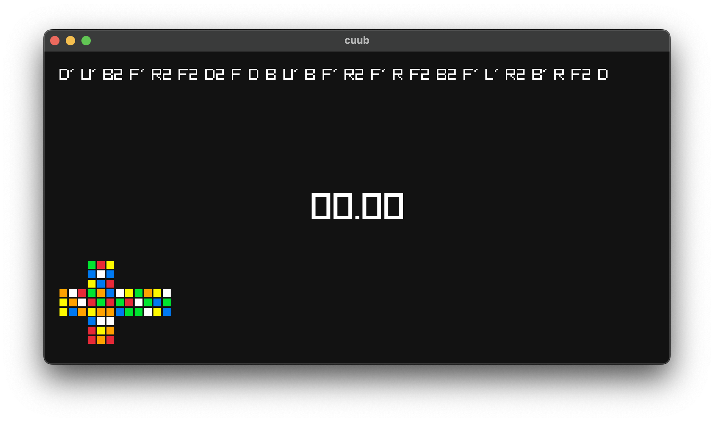

# cuub
Timer for cubing written in pure C with Raylib.

  

## Building
Do `make` to build the `cuub` binary
Then `sudo make install`

## Usage
- `+`, `-`, `0` to change font size
- `space` or `left mouse button` to start timer, stop it, reset timer and scramble
- `s` to toggle scramble & cube view

## Thanks to
cuub uses a slightly modified version of noocsharp's scramble generator
- https://github.com/noocsharp/scramble
